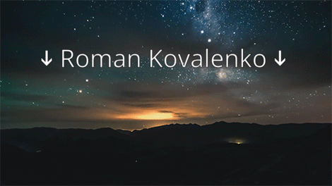

successfully downloaded text file (SHA: b667b7c67778282815ca0ce3b7c1a0512e05b0d1)

###  Welcome to my page!

**Roman Kovalenko**  
**Senior Web Developer (React, TypeScript, Node.js)** · 5+ years in product development

*Moscow, Russia*

 

## About me

Senior Web Developer with 5+ years of experience building high-load B2C/B2B products in **fintech**, **e-commerce** and **enterprise**.

- Strong in **React**, **TypeScript**, **Next.js**, **Node.js** and frontend architecture (microfrontends with Module Federation, Feature-Sliced Design).
- Focus on **performance** (Web Vitals, Lighthouse, bundle size) and scalable solutions.
- Experience with **CI/CD**, unit and e2e testing (Jest, Vitest, Puppeteer, Playwright), and improving development processes.
- Mentorship, code review, and work in cross-functional teams (up to 60 people).

 

## Featured project

### [3D WEB Racing Platform](https://github.com/ramach05/3D-WEB-Racing-Platform)

Browser time-trial 3D racer: **React 19 + React Three Fiber + Rapier (WASM)** physics on the front, **NestJS 11 + Prisma 7** on the back. pnpm monorepo, Feature-Sliced Design, steady ~60 fps.

- 3 tracks with distinct weather and procedural graphics, 5-car garage
- Audio 100% synthesized at runtime (Web Audio API) — zero audio files
- Rotating httpOnly refresh tokens with theft detection
- 572 unit/integration tests + 5 Playwright flows, CI-gated

 

## Tech stack

**Core**

**3D & backend**

**State & architecture**

**Styling & UI**

**Testing & tools**

 

## Contact

